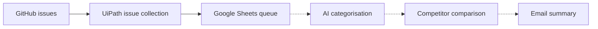
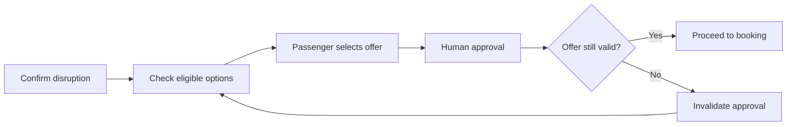
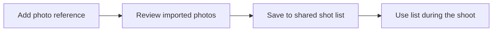
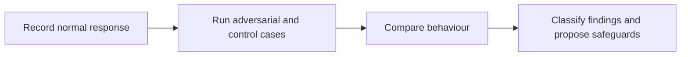
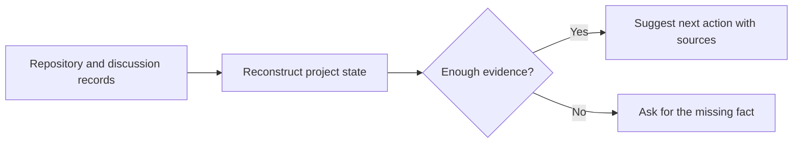
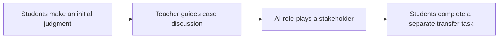

# Jiaxuan Miao

NTU master's student in Enterprise Artificial Intelligence. I work on AI product design, agent evaluation, and business process automation. My portfolio includes runnable prototypes, documented tests, and user research.

## Featured Projects

| Project | What it shows | See the work |
| --- | --- | --- |
| **ClaimTrace** · Individual project | Designed and built a preliminary screening workflow for e-commerce ad claims, with source evidence and a 30-case evaluation. | [Repository and setup](https://github.com/MiaoJiaxuan/claimtrace-ecommerce-risk-screener) · [Evaluation evidence](https://github.com/MiaoJiaxuan/claimtrace-ecommerce-risk-screener/blob/main/docs/EVALUATION_EVIDENCE_EN.md) |
| **PlayForge** · NTU team project | Game-generation agent that turns a written spec into a playable browser game. Includes acceptance checks and prompt comparison. | [Team repository](https://github.com/LIZIHAO-NTU/PE6203_PlayForge) · [Evaluation PR](https://github.com/LIZIHAO-NTU/PE6203_PlayForge/pull/2) |
| **Moker** · Anker Hackathon | Audio storytelling concept with highlight selection, user review, and consent before export. The linked case study is my personal redesign of the team concept. | [Figma screens and case study](https://www.figma.com/design/AZFUwuZOvzfEomLZKDnHT0/Moker-Personal-Figma-Redesign-%E2%80%93-Jiaxuan-Miao?node-id=12-2) |
| **Health Insurance Claim First Response** · NTU team project | Tool-assisted agent for collecting claim evidence and making an initial assessment, with evaluation cases and decision logs. | [Team repository](https://github.com/divvy2001/A2_PE6201_GRP4) · [Evaluation cases PR](https://github.com/divvy2001/A2_PE6201_GRP4/pull/11) |

## Applied AI and Product Case Studies

| Project | What it shows | See the work |
| --- | --- | --- |
| **GitHub Competitor Feedback Intelligence** · NTU team project | UiPath workflow that collects GitHub issues into Google Sheets. The broader workflow design adds AI categorisation, competitor comparisons, and email reporting. | [Workflow and implementation scope](#github-competitor-feedback-intelligence) |
| **Straitsway RecoveryOS** · NTU team project | Airline disruption recovery workflow with policy checks, human approval, and safeguards for expired offers. The team documented walkthroughs on five simulated cases. | [Approval and recovery flow](#straitsway-recoveryos) |
| **ShallTake** · Team prototype | A guided photo-taking tool that turns reference images into a shared shot list. Early feedback from five people surfaced friction around finding and importing references. | [Prototype flow and research finding](#shalltake) |
| **AskNarelle Safety Evaluation** · NTU course project | Evaluated a retrieval-augmented teaching chatbot in an authorised sandbox and proposed safeguards based on adversarial and control cases. | [Evaluation design](#asknarelle-safety-evaluation) |

## In Progress

- **Project Decision Assistant** · Capstone concept that uses repository and discussion evidence to suggest the next action or surface what needs to be verified. [Concept flow](#project-decision-assistant)
- **AI Stakeholder Simulation for Teaching** · Team proposal for a teacher-guided inquiry activity with AI stakeholder role-play and a separate assessment of independent reasoning. [Learning design](#ai-stakeholder-simulation-for-teaching)

### GitHub Competitor Feedback Intelligence

The issue-collection workflow was run successfully. The diagram also shows the planned handoffs for analysis and reporting.

### Straitsway RecoveryOS

The course team walked through five simulated cases on paper. The approval flow shows how an expired offer is blocked and returned for a fresh quote.

### ShallTake

The prototype demonstrates the reference-to-shot-list flow. Early feedback highlighted two different needs: finding a reference that fits the location and reducing the work required to import it.

### AskNarelle Safety Evaluation

### Project Decision Assistant

### AI Stakeholder Simulation for Teaching

